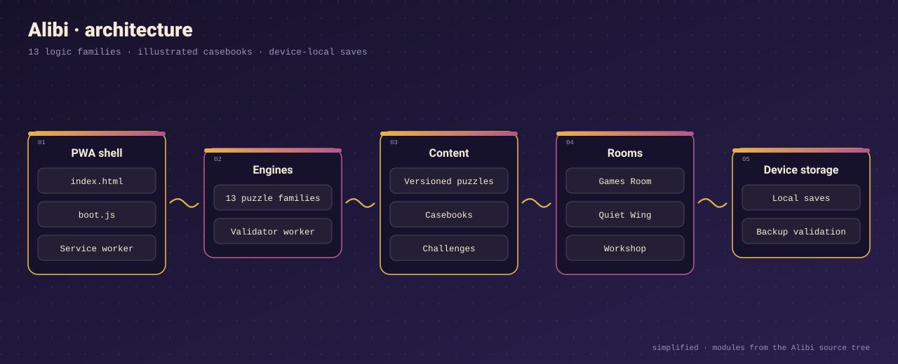
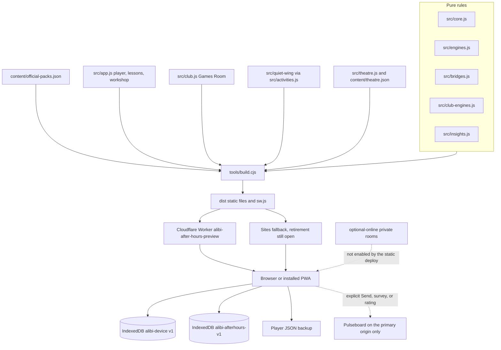

# Alibi

<p align="center"></p>

Alibi is a static, device-local puzzle cabinet: thirteen logic families, illustrated casebooks, and a workshop that does not need an account.

[](https://github.com/Chris0Jeky/Alibi/actions/workflows/check.yml)
[](package.json)
[](LICENSE.md)

[Play the primary site](https://alibi-after-hours-preview.commit-atlas.workers.dev/) ·
[Sites fallback](https://alibi-puzzle-club.jeky-tck.chatgpt.site/) ·
[Latest release](https://github.com/Chris0Jeky/Alibi/releases/latest) ·
[Project map](docs/PROJECT-MAP.md) ·
[Roadmap](ROADMAP.md) ·
[Author a puzzle](docs/AUTHORING.md)

Source package **0.15.2**. Check the [release record](docs/RELEASE-0.15.2.md) and [project state](docs/STATE.md) for source/build evidence, publication status, and same-origin save/update receipts. Commits after a publication receipt are not automatically deployed. The Sites address is the retiring fallback; see [Status](#status-and-roadmap). A Capacitor Android preview exists in the tree. There is no Play Store release and no completed physical-device acceptance.


## What it is

Alibi started as a compact puzzle club and grew into one static site you can install. The solvers, the catalogue, and the saves stay in the browser. Progress is an IndexedDB record on that origin, pinned to the puzzle revision you actually opened, so a later content edit does not silently rewrite a game in progress.

It is built as three layers that share that contract:

1. **The cabinet.** Versioned logic puzzles and five illustrated casebooks, with lessons, notes, undo and redo, reasoning hints, a reopenable conclusion, favorites, and a JSON backup you control.
2. **The house.** The Games Room, Quiet Wing, Wrenmere, eight atmospheric rooms, companions, and optional media that load beside the core instead of inflating it.
3. **The workshop.** Local authoring and validation. A pack you install on your own device is not a public publication.

The point is a calm place to deduce something, leave, and come back to the same board. Offline. Without an account.

## Features

Counts below are the trusted registry in `content/official-packs.json`: 32 packs, 570 puzzles. Nine packs listed in its `deferred` list (167 puzzles: the Vault packs, advanced Crime Scene variations, Interlock routes and gardens, Expert Families and Master/Grandmaster studies) load after startup from a precached file; the other 403 are in the initial bundle. `build-info.json` `deferredPuzzles` reports the current split, and [docs/content/DELIVERY.md](docs/content/DELIVERY.md) shows how to defer a pack. `content/catalog.json` is the original 116. `content/legacy.json` holds 40 compatibility fixtures and is not extra playable catalogue. Casebook chapters point at catalogue ids; they are not second copies.

### Thirteen families

Player names come from `src/presentation.js`. Engines live in `src/core.js` (crime scenes, Sudoku, picture logic, Sun & moon, Futoshiki), `src/engines.js` (alibi files, witness statements, lanterns, tents, aquariums, signal paths, number trails), and `src/bridges.js` (tidal bridges).

| Family | Id | Puzzles |
| --- | --- | ---: |
| Tidal bridges | `bridges` | 44 |
| Crime scenes | `scene` | 43 |
| Alibi files | `dossier` | 29 |
| Witness statements | `witness` | 31 |
| Picture logic | `nonogram` | 40 |
| Lanterns | `lightup` | 52 |
| Tents & trees | `tents` | 44 |
| Aquariums | `aquarium` | 44 |
| Signal paths | `network` | 44 |
| Number trails | `trail` | 44 |
| Sudoku | `sudoku` | 49 |
| Sun & moon | `binary` | 55 |
| Futoshiki | `futoshiki` | 51 |
| **Total** | | **570** |

Inside that 570: thirteen 16-puzzle curation packs (208), the night studies, six 15×15 picture-logic studies, the 80 Vault studies, and the 60 Interlock studies (24 Gardens, 36 Routes). Difficulty labels are provisional until player ratings and solve data say otherwise ([calibration](docs/CALIBRATION.md)). Hints in `src/insights.js` reason from the clues and the current board. They do not read `solution`. An explicit reveal is a separate, labeled action.

### Casebooks

`content/casebooks.json` has five books:

- *The Last Light at Bellweather* — six continuous records.
- *The unfinished invitation* — eight continuous records.
- *The Briar House papers*, *The midnight departure*, and *Secrets under glass* — anthologies of existing puzzles, four chapters each.

### Games Room

`src/club.js` offers six tables plus the living atlas: Lantern Duel, Tic-Tac-Toe, Lantern Gardens, Block Cabinet, Pocket Borough, and Archive Heist (nine rooms, then 24 Expert and Master vaults). Pocket Borough can open today’s town from the device date (`DAY-` plus the UTC date). Draw Dominoes and Mahjong Solitaire stay in `src/club-engines.js` for saved games; they are not on the offered-game list. Cascade Cabinet (`src/block-cabinet/cascade.mjs`) is a separate lab mode with its own replay rules, not a replacement for Block Cabinet saves. Club progress uses IndexedDB database `alibi-afterhours-v1`.

### Quiet Wing, rooms, and workshop

Quiet Wing (`src/activities.js`, `src/quiet-wing/`) is optional and loaded when you enter it: a realm builder, four companions (cat, fox, owl, dragon), gardens, and 95 release-owned challenges in `content/challenges/`. Those challenges are not part of the 570. The Curation Cabinet’s editorial layer is the 208-puzzle subset above, not a second app.

`content/theatre.json` defines eight atmospheric rooms and four short films. Room sound and films are extras; the puzzles still run without them. See [theatrical edition](docs/THEATRICAL-EDITION.md) and [asset delivery](docs/ASSET-DELIVERY.md).

The workshop validates a definition, checks uniqueness where that family’s contract allows it, and can export or install a local pack. Imports are JSON, checked in a bounded worker (3 MB and 150 puzzles per pack). Local install is not publication.

### Saves and offline

Cabinet saves use IndexedDB database `alibi-device`, version 1 (`src/storage.js`): revision-pinned continuations, notes, undo and redo, favorites, recovery, and JSON backup. The service worker (`sw.js`, emitted by the build) caches application files. Optional room and media packs stay off the critical path. Two origins do not share storage. Export the cabinet, Club, and Quiet Wing backups, and the separate challenge export, before you change site, browser, or device.

## Architecture

<p align="center"></p>



| Region | What it owns |
| --- | --- |
| `src/core.js`, `src/engines.js`, `src/bridges.js` | Puzzle rules, validation, bounded solvers |
| `src/insights.js` | Clue-based hints and completed-record explanations |
| `src/storage.js` | Cabinet saves, revisions, conflict detection, restore |
| `src/app.js`, `src/presentation.js` | Routes, player, lessons, workshop, family copy |
| `src/club.js`, `src/club-engines.js`, `src/atlas.js` | Games Room, legacy tables, harbour atlas |
| `src/block-cabinet/` | Block Cabinet surface and the Cascade lab |
| `src/activities.js`, `src/quiet-wing/`, `src/challenges.js` | Optional wing and the 95 challenges |
| `src/theatre.js`, `src/asset-delivery.js` | Rooms, sound/film presentation, optional images |
| `src/voices.js`, `src/voices-queue.js` | Feedback, survey, and ratings queue |
| `tools/` | Build, localhost server, pack validation, release prep |
| `tests/`, `.github/workflows/` | Node contracts and browser acceptance |
| `wrangler.jsonc`, `.openai/hosting.json` | Primary Worker and the Sites project |
| `optional-online/` | Separate private-room Worker; off unless you run it |

[AGENTS.md](AGENTS.md) is the agent entry. [STATE.md](docs/STATE.md) is the live handoff. [CONTRIBUTING.md](CONTRIBUTING.md) is the human one.

## Quickstart

Node.js 22 or newer (`package.json` `engines`). The shipped game has no runtime dependencies. esbuild, Wrangler, Prettier, Sharp, and Capacitor are devDependencies.

```sh
npm ci
npm run verify
npm start
```

Open `http://127.0.0.1:8797`. `npm start` is `node tools/serve.cjs`. It binds to `127.0.0.1` and serves `dist/`, the last production build. `npm run verify` formats, runs `tools/build.cjs` via the Android payload step, then the Node suites. After you edit source, run `npm run build` before `npm start`. `npm test` checks a clean source commit and the build receipts first; a dirty tree stops with a rebuild instruction.

Check one authoring example without the full suite:

```sh
node tools/validate-pack.cjs examples/twelve-families.json
```

That file is a teaching pack for the original families, not extra catalogue.

Optional browser acceptance uses Python and Playwright:

```sh
python -m venv .venv
# Activate the environment, then:
python -m pip install -r requirements-dev.txt
python -m playwright install chromium
python tests/browser_ui.py
python tests/browser_origin.py
python tests/browser_update.py
python tests/browser_expedition.py
```

On Windows, use `.venv\Scripts\python.exe` and set `PYTHONUTF8=1`. `tests/browser_ui.py` drives the thirteen families in an isolated document. `tests/browser_origin.py` uses real IndexedDB and service workers in a disposable profile. Neither is a physical phone.

Developer asset gallery, not a public route:

```sh
npm run assets:gallery
```

That serves the source-backed library at `http://127.0.0.1:8790/`.

The main CI workflow is [Verify puzzle cabinet](.github/workflows/check.yml) (Node 22, `npm run verify`, then the browser suites). Other workflows under `.github/workflows/` cover narrower controls. A green run is not physical-device acceptance.

## Tech stack

| Piece | Choice |
| --- | --- |
| Language | JavaScript. Engines are plain functions, no DOM and no network |
| App runtime dependencies | None |
| Build | `tools/build.cjs` emits hashed static files, a service worker, and `build-info.json` |
| Tooling | Node `>=22`, esbuild 0.28.2, Prettier 3.9.6, Sharp 0.35.5, Wrangler 4.146.0 |
| Player storage | IndexedDB `alibi-device` version 1, plus `alibi-afterhours-v1` for the club |
| Hosting | Cloudflare Workers static assets (`wrangler.jsonc`). Sites config remains in `.openai/hosting.json` |
| Android | Capacitor 8.5.2 preview flavors via `npm run build:android`. Not a store artifact |
| Tests | `node --test` and Playwright (`requirements-dev.txt`) |
| Feedback collector | Pinned Pulseboard SDK on the primary origin only (`observatory/`) |

## Status and roadmap

**Shipped in source at 0.15.2.** Thirteen families, 570 registry puzzles, five casebooks, the Games Room, Quiet Wing, the workshop, offline install of the core, the beta/feedback client, optional Desk and Games Room paintings, and navigation/family pictograms. Source/build, Cloudflare publication, public-file, and same-origin save/update receipts are tracked in the [0.15.2 release record](docs/RELEASE-0.15.2.md) and [project state](docs/STATE.md).

**Sites.** Owner decision 2026-09-27: retire `https://alibi-puzzle-club.jeky-tck.chatgpt.site/` with one deployment that shows a moved notice and an export path. That deployment is still open ([HUMAN_TODO.md](HUMAN_TODO.md) q-9). On 12 October 2026 that origin returned HTTP 200 and its platform identity reported `appVersion` 0.12.0. Current `src/boot.js` shows “Alibi has moved” only when the page is opened on that Sites host, so the notice is not in the 0.12.0 shell. Nothing redirects, and nothing deletes the saves that live there.

**Not claimed.** Production Android, a Play Store listing, cloud sync, accounts, public multiplayer, tamper-resistant scores, a content marketplace, calibrated difficulty across the catalogue, or a licence to reuse the source. The written list is in [ROADMAP.md](ROADMAP.md) under “Not currently claimed”. Physical Android, TalkBack, and the affected-device freeze retest stay in [HUMAN_TODO.md](HUMAN_TODO.md). Two people have played and enjoyed it (owner report, 2026-09-09). That is an early qualitative note, not a device matrix. See [player QA](docs/PLAYER-QA.md).

**Roadmap, last reconciled in that file on 23 September 2026.** It is a plan, not a changelog:

- **A.** Human evidence for pacing, wording, and difficulty, with old revisions kept for existing saves.
- **B.** Per-family solver contracts. Fail closed when a family cannot honestly solve from a partial board.
- **C.** Wrenmere as an optional mobile home, with the classic cabinet kept as the recovery path.
- **D.** Capacitor Android, after signing, transfer, TalkBack, and store gates. Preview APKs are not that release.
- **E.** Accounts, sync, public scores, and payments only if a real player need shows up and the privacy and conflict costs are accepted.

The working title in the app, database, and URLs is Alibi. On 2026-09-27 the owner recorded **Postern** as the product-name direction. That is not a rename and not a trademark clearance ([NOTICE.md](NOTICE.md), [HUMAN_TODO.md](HUMAN_TODO.md) q-3).

## Privacy, licence, and contributing

Progress stays in this browser on this device. There is no mandatory account, advertising system, or payment service. On the primary Cloudflare site a one-line Beta notice (never an overlay) explains usage data sent to Pulseboard: counts, diagnostics, and journeys with official puzzle ids, family, tier, and numbers only. OK accepts. Choose, or the Beta button in Settings and Privacy, changes it. EEA visitors get counts only until OK. GPC or DNT turns collection off. Separately, a player can send feedback, answer a short survey, and rate an official puzzle ([how it works](docs/FEEDBACK-AND-SURVEYS.md)). Nothing in that channel is sent until they press Send, submit, or tap, whatever their Beta choices. Messages carry no identifier. Surveys and ratings carry a random survey key created on the device, resettable in Privacy. Unsent items wait on the device (at most 20, for 30 days). The Sites fallback, the standalone file, and the Android preview send nothing. Hosting and the collector can still see ordinary request data, including IP addresses. Read [security and privacy](docs/SECURITY-AND-PRIVACY.md) before making a stronger claim.

Solutions ship with the app so checking and explicit reveals work offline. Scores are not competitive and not tamper-resistant. Backups are unencrypted. Notes can contain personal information.

Report a suspected secret exposure, unsafe import, or save-loss bug through [SECURITY.md](SECURITY.md). Do not attach a real player database to a public issue.

The source is [PolyForm Strict License 1.0.0](LICENSE.md). You may read it and use the software for noncommercial purposes. You may not distribute it, change it, or make new works based on it. This is source-available, not open source. See [NOTICE.md](NOTICE.md). Bug reports and suggestions are welcome as issues. Code or content contributions need a separate written agreement with the maintainer first; open an issue before a pull request. [CONTRIBUTING.md](CONTRIBUTING.md) has the verification loop.

## Links

- [Project map](docs/PROJECT-MAP.md)
- [Live handoff](docs/STATE.md) and [owner decisions](HUMAN_TODO.md)
- [Roadmap](ROADMAP.md)
- [Authoring](docs/AUTHORING.md)
- [After Hours map](docs/AFTER-HOURS-MAP.md)
- [Quiet Wing](docs/QUIET-WING.md)
- [Theatrical edition](docs/THEATRICAL-EDITION.md)
- [Asset library](docs/ASSET-LIBRARY.md) and [asset delivery](docs/ASSET-DELIVERY.md)
- [Deployment](docs/DEPLOYMENT.md) and [Android / Capacitor](docs/ANDROID.md)
- [0.15.2 release record](docs/RELEASE-0.15.2.md)
- [Player QA](docs/PLAYER-QA.md)
- [Security](SECURITY.md) and [privacy notes](docs/SECURITY-AND-PRIVACY.md)
- [Licence](LICENSE.md) and [notice](NOTICE.md)
- [Contributing](CONTRIBUTING.md)
