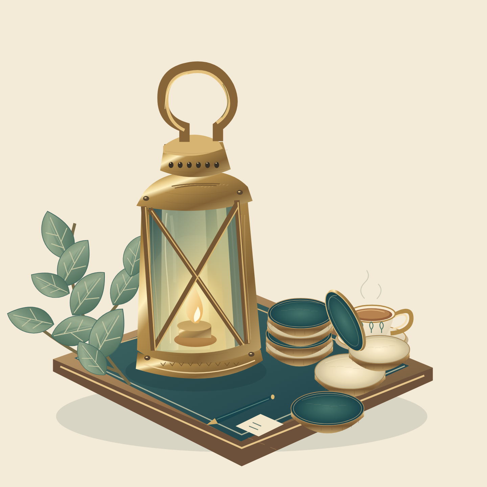

# Alibi material study 02

Version 1 remains unchanged in the parent directory as an early study below the requested illustration quality bar. This source-only iteration adds optical and material modelling while retaining its palette and objects.

`lantern-counter-vignette-v2.svg` is an 800×800 native SVG with 12 editable named layers. Curved glass reflections and warm flame irradiance replace the flatter glazing; patinated brass has edge and wear highlights. Counters have individual radial face shading, bevel/profile marks and uneven surface wear. Sage leaves use cupped halves and restrained material gradients.

The original painted Lantern Duel reference remains richer in irregular texture. The revised vector is an illustrated material study, not a claim of picture-equivalent finish or production acceptance. `review.html` compares the unchanged painted source and both SVG iterations. Actual full and 390px Chromium pixels were inspected; the combined comparison/lifecycle probe passes 36 checks. Native Gaussian blur supports static light modelling; no raster embedding, external content or script exists in the master.

Both iterations remain outside runtime/precache. Existing optional painting delivery, the eight-slot cache, 1 MiB/image bound, rules, save identities and ceilings are unchanged. Combined icon/painting qualification is handled separately. No merge or deployment.
